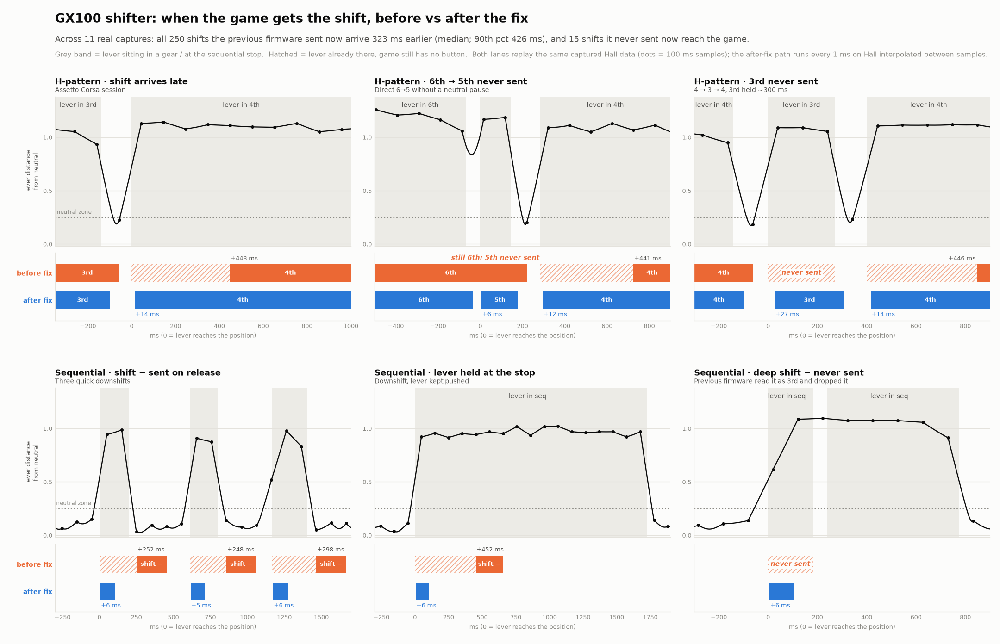

# ShifterNoumi

Open replacement firmware for the **GX100 H-pattern / sequential USB shifter** (the
AliExpress unit built around an STM32F103C8T6 "Blue Pill" and six analog Hall
sensors). It turns the shifter into a standard USB gamepad that your sim sees
immediately, and lets you do everything from the lever itself — no vendor PC
software to launch before a session.

[](https://youtu.be/y1l9Ku8SqPg)

*Presentation video (YouTube): what ShifterNoumi does and how it is used.*

| | Stock firmware | This firmware |
|---|---|---|
| Switch H-pattern ↔ sequential | Vendor PC app | Lever + collar gesture ([user guide](docs/user-guide.md#switching-between-h-pattern-and-sequential)) |
| Calibration | Vendor PC app | Guided, on the lever, saved to flash ([user guide](docs/user-guide.md#calibration)) |
| H-pattern gear → game | — | Sent ~6–10 ms after the lever settles in the gate |
| Sequential shift → game | — | Sent as the lever hits the stop, not on release |
| Live diagnostics | — | Virtual COM port streaming raw sensors + internal state |



*Real captures replayed through the firmware before and after the low-latency
path was added: shifts arrive ~320 ms earlier (median), and shifts that were
previously dropped (direct 6→5, quick 4→3→4, deep sequential downshifts) now
reach the game. See [Algorithms → fast path](docs/algorithms.md#the-fast-path).*

> **Project status — read before flashing.** Validated on the author's unit
> (Oct. 2026): H-pattern, reverse, sequential, mode switching and the saved
> mode, the low-latency path in game (13 ms median from the lever reaching the
> gate to the gear in Assetto Corsa), guided calibration with its checks, the
> USB bootloader and `shifternoumi-setup` (update, recovery, install through an
> ST-Link, including from a read-protected chip). Only one physical unit has
> been tested so far; other production batches may differ. See
> [Known issues](docs/known-issues.md).

> **Provided "AS IS", without warranty of any kind.** Flashing this firmware
> erases the stock firmware for good, and opening, wiring and flashing the
> shifter can damage it, your ST-Link or your PC. You do it at your own risk:
> the author accepts no responsibility for any damage or loss (see sections 7
> and 8 of the [Apache License 2.0](LICENSE)).

## How it works, in one paragraph

A magnet under the lever moves above six linear Hall sensors. Every
millisecond the firmware reads all six, normalizes them against your
calibration, and finds which calibrated position the lever is closest to
(nearest neighbour in a 6-D space). In H-pattern mode that position is held as
a gamepad button (1–6, or 11 for reverse when the collar is lifted); in
sequential mode each push to the stop emits one short *shift +* / *shift −*
pulse. A slower 100 ms state machine runs alongside to recognise the
mode-switch and calibration gestures. Details in
[Architecture](docs/architecture.md).

## Quick start

1. **Hardware**: GX100 shifter, an ST-Link V2 (or clone), four jumper wires.
   The stock firmware is read-protected — flashing this one **erases it for
   good** (it cannot be backed up). See [Hardware](docs/hardware.md).
2. **Install**: run `shifternoumi-setup` with the ST-Link connected. See
   [Installation](docs/installation.md). To build from source instead, see
   [Building and flashing](docs/building-and-flashing.md).
3. **Calibrate** once on the lever (about two minutes, no PC tool). See
   [User guide → Calibration](docs/user-guide.md#calibration).
4. **Map buttons** in your sim: gears 1–6 = buttons 1–6, reverse = button 11,
   sequential up/down = buttons 7/8.

## Documentation

| Page | For | Contents |
|---|---|---|
| [Installation](docs/installation.md) | Drivers | First install with shifternoumi-setup, wiring, updates |
| [User guide](docs/user-guide.md) | Drivers | Modes, gestures, reverse, calibration, LED codes, troubleshooting |
| [Hardware](docs/hardware.md) | Everyone | Board, pinout, sensors, what each gear looks like to the sensors |
| [Building and flashing](docs/building-and-flashing.md) | Builders | Toolchain, read-protection unlock, CubeMX regeneration pitfalls |
| [USB bootloader and shifternoumi-setup](docs/bootloader.md) | Builders, contributors | USB updates, the installer, flash map, hardware validation |
| [Architecture](docs/architecture.md) | Contributors | Module map, main loop, data flow, timing |
| [Algorithms](docs/algorithms.md) | Contributors | Classification, movement tracker, fast path, gestures, calibration |
| [USB interface](docs/usb-interface.md) | Contributors, tool authors | Composite device, HID report layout, debug CSV stream |
| [Configuration reference](docs/configuration-reference.md) | Tuners | Every tunable constant, its value and why |
| [Testing and tools](docs/testing-and-tools.md) | Contributors | Host tests, capture replay, capture and plotting scripts |
| [Design history](docs/design-history.md) | Reviewers | Why things are the way they are, what was tried and dropped |
| [Known issues](docs/known-issues.md) | Everyone | Limitations and open problems |
| [Contributing](CONTRIBUTING.md) | Contributors | Workflow, conventions, what to test |

Code comments (French) sometimes refer to `PLAN.md` or `PCB/…`: those live in
the development archive, a separate repository holding the day-by-day journal,
the Python prototypes and every capture recorded during development.

## Repository layout

```
Firmware/            Production firmware (STM32CubeIDE project)
  App/Inc, App/Src   Application logic — HAL-free except a few small adapters
  App/test/          Host tests and capture replay tools (gcc)
  Core/, Drivers/    CubeMX-generated startup, HAL, clock/ADC/GPIO setup
  USB_DEVICE/        USB device: composite HID gamepad + CDC debug port
  Middlewares/       ST USB device library (with small, marked edits)
  Makefile           Command-line build (no IDE), with or without bootloader
Bootloader/          4 KB USB (HID) bootloader for updates without an ST-Link
Wizard/              shifternoumi-setup: installer/updater (Python, packaged per OS)
Diag/Gx100_DiagFirm/ Minimal diagnostic firmware used to map the sensors
hardware/
  kicad/             Schematic of the stock board as reverse-engineered (KiCad)
  photos/            The board, opened
tools/               Capture, streaming, analysis and plotting scripts (Python)
captures/            Real captures the host tests replay
docs/                This documentation (images/ for its figures)
```

## License

ShifterNoumi (firmware, bootloader, installer, tools and documentation) is
released under the [Apache License 2.0](LICENSE): use it, change it, share it,
sell it, keeping the license and the [NOTICE](NOTICE). Copyright 2026
Klakinoumi.

It is provided **"AS IS", without warranty of any kind**, and the author
declines all responsibility for any damage or loss resulting from its use
(sections 7 and 8 of the license).

Third-party code keeps its own terms: the ST HAL and CMSIS under
`Firmware/Drivers/` (see the `LICENSE.txt` files there), the ST USB device
library under `Firmware/Middlewares/` (ST's SLA0044: use on ST microcontrollers
only), and what the installer executables bundle
([THIRD-PARTY-NOTICES](Wizard/THIRD-PARTY-NOTICES.md)).
