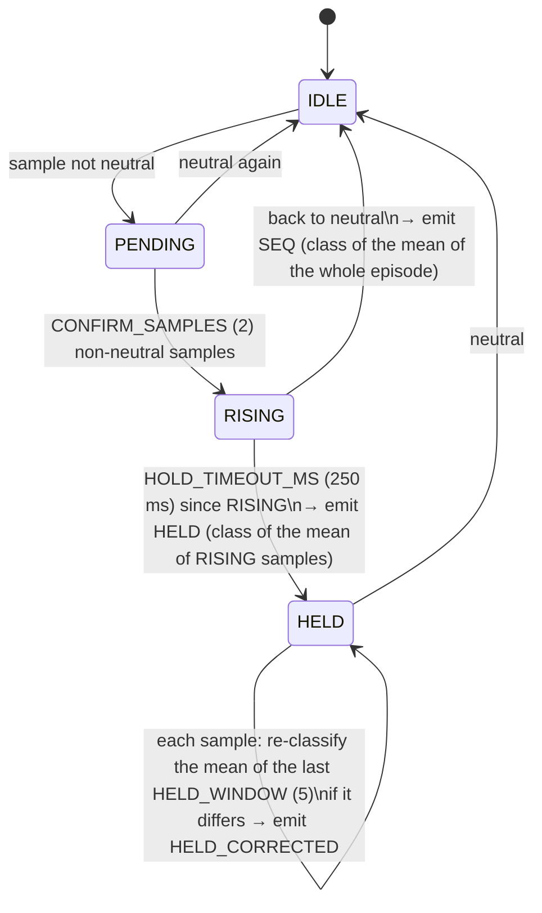

# Algorithms

How the firmware turns six analog readings into gears, shifts, mode switches
and calibration points. Read [Architecture](architecture.md) first for where
each piece runs.

## Contents

1. [Classifying a sample](#1-classifying-a-sample)
2. [The movement tracker (slow path)](#2-the-movement-tracker-slow-path)
3. [The fast path](#the-fast-path)
4. [Mode-switch gestures](#4-mode-switch-gestures)
5. [Calibration](#5-calibration)
6. [Calibration persistence](#6-calibration-persistence)
7. [Status LED](#7-status-led)

---

## 1. Classifying a sample

`App/Src/gear_position.c`

### Calibration points

A calibration is nine reference samples (raw U2..U7 values), one per
position: neutral, 1st–6th, seq +, seq −. Each position also has a fixed
**intrinsic mode**: H for gears 1–6, SEQ for seq ±, none for neutral.

### Normalization

Sensors don't move by the same amount (U6 swings ~1270 counts, U4 ~810), so
raw distances would let the biggest movers dominate. Each sensor *i* is
rescaled so that 0 is its neutral reading and ±1 is its largest excursion
across all calibrated positions:

```
neutral_i = positions[NEUTRAL].v[i]
scale_i   = max over non-neutral positions p of |positions[p].v[i] − neutral_i|   (≥ 1)
norm_i(x) = (x_i − neutral_i) / scale_i
```

`gear_position_compute_normalization()` recomputes `neutral[]`/`scale[]`
at load and whenever a new calibration is applied.

### Distances

All decisions use the Euclidean distance between normalized vectors. With the
default calibration, the geometry is:

| | from neutral | nearest other point |
|---|---|---|
| gears 1–6 | 1.06–1.22 | ≥ 0.83 (1st↔5th↔3rd) |
| seq + | **0.46** | 0.62 (4th) |
| seq − | 0.86 | **0.30 (3rd)** |

At rest, noise stays below ~0.2 from neutral. A lever sitting in a gate reads
within ~0.15 of its point (90th percentile over the Assetto Corsa captures).

- `gear_position_is_neutral()`: distance to neutral < **0.25**.
- `gear_position_classify()`: nearest neighbour over all nine points.

The two small distances in bold are what make the problem interesting:
*seq +* has a short travel close to neutral, and *seq −* is nearly
indistinguishable from 3rd. The mode switch gesture exists because of the
second one.

---

## 2. The movement tracker (slow path)

`movement_tracker_*` in `App/Src/mode_state_machine.c`, stepped every 100 ms.

It turns the sample stream into discrete, confirmed movements. Each
confirmation has a *kind*: `SEQ` (a brief excursion that came back to
neutral), `HELD` (a position held), or `HELD_CORRECTED` (the held position was
re-evaluated to a different one).



Design notes, each one fixing a failure seen on real captures:

- **Classify an average, not a sample.** 3rd and seq − differ by
  ~50–100 counts on U2/U4, the same order as the noise. Averaging the
  whole episode removed most misclassifications.
- **`HELD` excludes the `PENDING` samples**, which are still close to
  neutral and dragged the average toward it; `SEQ` includes them, because a
  brief tap has only a handful of samples.
- **Continuous re-evaluation while held** (`HELD_CORRECTED`) catches a
  confirmation that fired before the lever finished travelling, and direct
  gate-to-gate moves that never pass through neutral.

`mode_state_machine_step()` then forwards a confirmed movement to the HID
layer only if its position's intrinsic mode equals the current mode
(`mode_courant`). A seq − in H mode is not a gear; a gear in SEQ mode is not
a shift.

This path is accurate but slow: at 100 ms per sample, a held gear is
confirmed ~350–450 ms after it leaves neutral, and a sequential tap only when
the lever comes *back*. Since the fast path was added, the tracker no longer
decides what the game sees; it still feeds the gesture detectors, the
calibration-entry detector and the debug trace.

---

## The fast path

`App/Src/fast_gear.c` + `hid_report_apply_fast_gear()` in
`App/Src/hid_report.c`, run every main-loop iteration (1 ms).

The idea: the mode is already known (set by an explicit gesture), so the
firmware does not need to wait to see how long a movement lasts to know
whether it is a gear or a shift. It only needs to know *where the lever is
now*.

### Engaging a position

On every sample, `fast_gear_step()` computes the distance to every
calibrated point and finds the nearest one, `p`. In **SEQ mode the H points
are left out** of the search: they can't be reached with the lever locked, and
a firm seq − push reads closer to 3rd than to seq −. `p` becomes a
*candidate* if all of these hold:

| Condition | Value | Why |
|---|---|---|
| `p` is not neutral and belongs to the current mode | — | H mode engages gears 1–6, SEQ mode engages seq ± |
| distance to `p` | < `FAST_GEAR_ENGAGE_DIST` = 0.35 | In-gate readings are ≤ 0.15 (p90) / ~0.30 (p99) |
| distance to neutral | > `FAST_GEAR_MIN_NEUTRAL_DIST` = 0.35 | A noisy neutral must never trigger seq + (only 0.46 away) |
| lead over the second-nearest point | ≥ `FAST_GEAR_MARGIN` = 0.08 | Rejects readings halfway between 3rd and seq − (the H→SEQ gesture); a real 3rd leads by ≥ 0.11 in every capture |

The candidate is **engaged** once it has been the candidate continuously for
`FAST_GEAR_ENGAGE_MS` = 6 ms, which filters single-sample spikes. A new
candidate can replace an engaged position directly (6 → 5 with no stop in
neutral).

### Releasing it

The engaged position is released once, for `FAST_GEAR_RELEASE_MS` = 15 ms
in a row, the lever is either farther than `FAST_GEAR_RELEASE_DIST` = 0.60
from it or back inside the neutral zone (< 0.25). The gap between 0.35
(engage) and 0.60 (release) is the hysteresis that stops a button from
flickering at the edge of a gate.

### After a mode switch

When the mode changes, `fast_gear` resets and **engages nothing until the lever
has visited neutral**. The switch to H is done while holding 6th, and that 6th
must not reach the game at the end of the gesture. This does not apply at
power-up, so a lever already in gear when you plug in is reported
immediately.

### Turning positions into buttons

`hid_report_apply_fast_gear()`, outside calibration mode:

1. Clears every gear/reverse/shift bit set by the slow path. The fast path is
   the only source of buttons.
2. **H mode**: sets the button of the engaged gear. On the transition *into*
   1st, the (fast-debounced) collar state is latched. If the collar was up,
   button 11 (reverse) is sent instead of 1 for as long as 1st stays engaged.
3. **SEQ mode**: each new engagement of seq +/− queues one pulse on button
   7/8. A pulse lasts `FAST_PULSE_MS` = 100 ms. Pulses queued while one is
   running are sent after a `FAST_PULSE_GAP_MS` = 30 ms gap, so two quick
   shifts are never merged into one.
4. **Calibration-entry mask**: when the calibration-entry detector is
   waiting for its last step (2nd, collar up), 2nd is not sent. That gesture's
   final move must never reach the game.

In calibration mode it does nothing except refresh the vendor axis bytes.

### Measured effect

Replaying 11 real captures through both paths
([`replay_fast_path.c`](../Firmware/App/test/replay_fast_path.c),
[`plot_fast_path.py`](../tools/plot_fast_path.py)):

- all 250 shifts the slow path sent are still sent, **323 ms earlier**
  (median; 90th percentile 426 ms);
- 15 shifts the slow path never sent are now sent, each checked by hand
  against the raw data: direct 6 → 5, quick 4 → 3 → 4, a 3rd held ~300 ms
  and discarded as a "tap", deep seq − pushes classified as 3rd and
  dropped;
- 2 spurious shift + pulses of the slow path (lever in 5th/6th while in SEQ
  mode) are gone.


Caveat: the captures have one sample per 100 ms. The replay runs the fast path
every 1 ms on values interpolated between samples, which approximates, but is
not, what the board sees.

Measured on hardware afterwards (Oct. 2026, Assetto Corsa, HID logged at 1 ms
with the raw sensor values, `tools/analyze_shift_latency.py`): from the lever
entering the gate (distance < 0.35) to the gear in the game, 13 ms median,
56 ms for 90 % of shifts, no shift missed in 60 H-pattern shifts; 9 ms to the
pulse in sequential (the game then adds the car's own ~95 ms shift time). The
slowest H shifts (up to ~100 ms) are all 3rd: while the lever settles, it is
not yet `FAST_GEAR_MARGIN` closer to 3rd than to seq −.

---

## 4. Mode-switch gestures

`switch_gesture_detector_*` in `mode_state_machine.c`, slow path. It consumes
the movement tracker's confirmations and the slow-debounced collar.

A **blip** is one collar lift-and-release lasting between `BLIP_MIN_MS`
(50) and `BLIP_MAX_MS` (700). A **pair** is two blips with at most
`INTER_BLIP_MAX_MS` (1200) between the end of the first and the start of the
second. Both gestures must complete within `GESTURE_TIMEOUT_MS` (5000) of the
most recent relevant event. The window is renewed on every step, so slow but
steady execution still works.

### To H-pattern: hold 6th + blip pair

- Armed when the tracker confirms 6th (`HELD` or `HELD_CORRECTED`). Each
  new confirmation of 6th renews the window.
- A blip only counts if the lever is on 6th when it completes. Briefly
  floating out of 6th between blips does not discard blips already counted.
- A valid pair → target H.

### To sequential: ≥ 2 seq − taps, neutral, blip pair

- Each seq − confirmed as `SEQ` (a quick tap, not a hold) increments a
  counter and renews the window.
- Once `SEQDOWN_MIN_COUNT` (2) taps are counted, blips are accepted while
  the tracker is idle (lever at neutral).
- A valid pair → target SEQ.

Two taps are required so that a single downshift followed by accidental
collar movement can't switch modes.

If the target equals the current mode, nothing happens. Otherwise
`mode_courant` changes, `last_switch_applied` is set for that step (the LED
double-flashes), and the fast path resets.

---

## 5. Calibration

### Entering calibration mode

`calibration_entry_detector_step()`: with the collar held up the whole time,
the tracker must confirm **1st → 5th → 6th → 2nd** in order. Rules:

- releasing the collar resets the sequence;
- confirming 1st restarts it at step 1;
- a `HELD_CORRECTED` to any other position is ignored (such corrections are
  transient artefacts while travelling to the next gate);
- any other clean confirmation (`HELD`/`SEQ`) resets it.

Completing the sequence enters calibration mode *before* 2nd would be emitted,
so 2nd never reaches the game.

### Calibration mode

`calibration_mode_step()` replaces all normal processing: no tracker, no
gestures, no buttons. It walks through
`CALIBRATION_SEQUENCE` = 1st, 2nd, 3rd, 4th, 5th, 6th, seq +, seq −,
neutral.

For the current target:

1. On a collar rising edge, reset the accumulator.
2. While the collar stays up, once `CALIBRATION_HOLD_MS` (2000) has elapsed,
   add every sample to a running sum (`triggered_for_this_hold` becomes true;
   the LED shows *ready*).
3. On the collar falling edge: if at least one sample was accumulated, the
   mean is checked (`calibration_mode_rejects()`), then kept in RAM
   (`calib_mode.pending[]`) as the new reference point for the target, and
   the sequence advances. Otherwise the attempt is dropped. The active
   calibration is not touched yet.
4. After the ninth point, calibration mode exits and hands the nine points
   to `calibration_store_commit()`, which applies them, recomputes the
   normalization and saves them to flash in one write (one slot). A
   calibration abandoned half-way (unplugged) changes nothing.

The check refuses a mean whose L1 distance (sum of the six absolute
differences, in ADC steps) is below `CALIBRATION_MIN_GAP_L1` (400) from a
point already recorded in the session (`CALIBRATION_MIN_GAP_CLOSE_L1`, 150,
between 3rd and seq −, which really are close), or below
`CALIBRATION_MIN_NEUTRAL_L1` (300) from the neutral of the calibration in
use at entry (all points but neutral). At the seq + step it also refuses a
point closer to the session's 3rd than to its 4th, and at the seq − step
the reverse: on every calibration recorded so far, seq − is 347–516 from
3rd and 2503–2662 from 4th, seq + 1072–1142 from 4th and 2069–2137 from
3rd. A refused point leaves the step where it is and increments
`rejected_count`, which the LED shows. Thresholds come from the recorded
calibration sessions (`test_Ben`, `test_H_pattern8/9`, Oct 2026): apart
from 3rd and seq −, two distinct points are at least ~700 apart and neutral
is 756–859 from the nearest point; neutral held again is 63–95 from the
stored neutral. A lever put back in a gate already recorded lands up to
~160 from its first reading (`calib_refus`: neutral taken in 1st, 157), so
the first threshold (150) missed it. The three clean sessions replay with
nine points accepted and none refused; `calib_refus` with its four mistakes
refused (`test_calibration_mode`). On hardware, a session with five
deliberate mistakes got five refusals and nine correct points.

The check catches a lever left in neutral, put back in a gate already
recorded, or on the wrong side for seq + / seq −. It cannot tell whether
the lever is in the *requested* gear when that gear has not been recorded
yet (4th recorded at the 3rd step is accepted), and nothing checks that the
neutral point is taken at rest; see [Known issues](known-issues.md).

---

## 6. Calibration persistence

`App/Src/calibration_flash.c`

Only the nine reference samples are stored (9 × 6 × 2 = 108 bytes). Modes
are a fixed table, and `neutral`/`scale` are recomputed at load.

- **Where**: the last 1 KB page of flash, `0x0800FC00`, as far as possible
  from the code.
- **Layout**: 8 slots of 128 bytes. Each written slot holds
  `magic "GX10" (u32) | sequence number (u32) | positions (108 B) | CRC-16/CCITT (u16)`.
  The rest stays erased (0xFF).
- **Load**: scan all slots, keep the valid one (magic and CRC OK) with the
  highest sequence number. No valid slot → built-in defaults.
- **Save**: write the whole calibration to the next slot with sequence + 1.
  When all 8 are used, erase the page and restart at slot 0. The sequence
  number keeps increasing, so "highest wins" stays unambiguous.
- **Endurance**: a full calibration is saved once (one slot), so the page is
  erased once every 8 calibrations. The F103 is rated for ~10 000 erase
  cycles.
- **Reset**: `shifternoumi-setup reset-calibration` makes the app erase the
  page and restart; with no valid slot, it loads the built-in defaults.
- **Power loss**: a write interrupted by a power cut leaves a slot that is
  neither blank nor valid. The CRC keeps it from ever being loaded, and the
  next save skips every slot that is not fully blank (erasing the page if
  none is left) instead of programming over the leftovers.

### The saved mode

`App/Src/mode_flash.c`. The current mode (H-pattern or sequential) is kept
in its own page, `0x0800F800`, just below the calibration. Each mode switch
appends one 16-bit record (`0x4848` H, `0x5353` SEQ; nothing is written if
the mode is unchanged), and the page is erased only when its 512 records are
used. At boot the last valid record wins; with none, the shifter starts in
H-pattern. A separate page means a power cut during that erase can at worst
lose the mode, never the calibration.

---

## 7. Status LED

`App/Src/status_led.c`. `status_led_step()` runs with the slow path and
picks the pattern; `status_led_output()` runs every 1 ms iteration and turns
the pattern's brightness (0–255, `status_led_level()`) into a software PWM
on PC13, which has no timer output. The pattern choice is a small priority
state machine over the patterns listed in the
[user guide](user-guide.md#led-codes):

1. **Mode switched** (double flash): started by `last_switch_applied` and
   always played to completion.
2. **Point recorded** (3 fast flashes): started when `calib_mode.step_index`
   advances (the point is in `pending[]`), or when calibration ends after the
   last point (the calibration has just been saved).
3. **Point refused** (fast flicker, 10 × 50 ms): started when
   `calib_mode.rejected_count` changes, played to completion, then back to
   *waiting* on the same point.
4. **Ready to save** (double blip, looping): while `triggered_for_this_hold`
   is true. It starts on the false → true transition and stops immediately
   when the hold ends.
5. **Waiting for a point**: any other time in calibration mode. One breath
   (`STATUS_LED_BREATH_MS`, brightness = triangle squared so the fade looks
   even), a gap, then the target point as pulses: 1–6 for gears, 7 for
   shift up, 8 for shift down, one long pulse for neutral. The pattern
   restarts from the breath whenever the target changes or a hold ends.
6. **Off**: otherwise.

Patterns start on a slow step (so up to 100 ms late), but their timing is
exact to the millisecond. Below brightness 16 the LED is simply off: the
1 kHz PWM would otherwise pulse slower than ~60 Hz and flicker.
