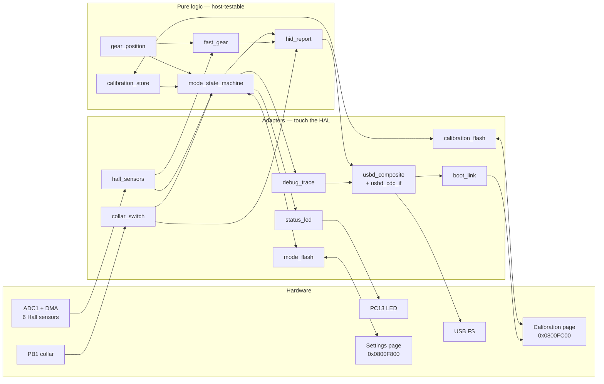
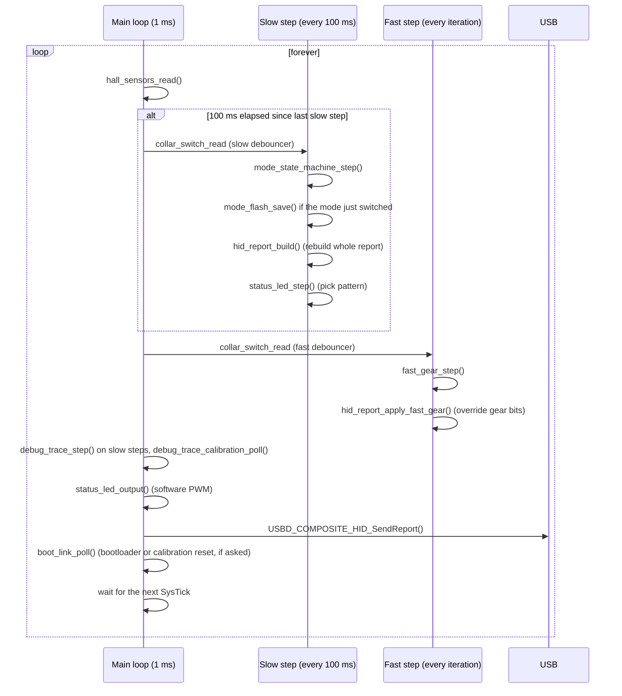

# Architecture

A tour of the production firmware in `Firmware/`: how it is split, what runs
when, and how one lever movement becomes a USB button press. For the maths and
state machines inside each module, see [Algorithms](algorithms.md).

## Design principles

- **Application logic has no hardware dependencies.** Everything under
  `App/` except a few thin adapters (marked in the table below) is plain C99 with no HAL or USB calls, so
  it can be compiled and tested on a PC and fed real captured data
  ([Testing and tools](testing-and-tools.md)).
- **Classify on all six sensors at once.** No per-sensor thresholds; each
  sample is compared with calibrated reference points in a normalized 6-D
  space.
- **Latency where it matters, stability everywhere else.** Gear buttons go
  through a fast path that runs every 1 ms. The gesture recognisers
  (mode switching, calibration) run on a 100 ms state machine whose timings
  were tuned on real captures and are left unchanged.
- **Everything is operated from the lever.** Mode switching, calibration
  and feedback (LED) need no PC software.
- **Static memory only.** No heap; all state lives in a few globals in
  `main.c`.

## Module map

| Module | Role | HAL? | Host tests |
|---|---|---|---|
| `hall_sensors` | Starts ADC1 in circular DMA once; returns a snapshot of the 6 values | yes | — |
| `collar_switch` | Reads PB1, debounces (2 consecutive equal reads) | read only | `test_collar_switch` |
| `gear_position` | Normalization and nearest-neighbour classification | no | via replay tests |
| `calibration_store` | Default calibration, load from flash, apply and save a complete new calibration | via `calibration_flash` | `test_calibration_mode`, replay tests |
| `calibration_flash` | Wear-levelled persistence of the 9 reference points | writes only | `test_calibration_flash` |
| `mode_flash` | Remembers the last mode (H / SEQ) across plug-ins | writes only | `test_mode_flash` |
| `mode_state_machine` | 100 ms state machine: movement tracker, mode-switch gestures, calibration entry and calibration mode | no | `test_replay`, `test_hid_replay`, `test_calibration_mode` |
| `fast_gear` | Every-iteration position detection (H gears / sequential stops) | no | `test_fast_gear` |
| `hid_report` | Builds the 16-byte HID report from both paths | no | `test_hid_report`, `test_fast_gear` |
| `status_led` | LED patterns for calibration and mode switches, software PWM | yes | `test_status_led` |
| `debug_trace` | One CSV line per slow step on the CDC port | via CDC | `test_debug_trace` |
| `usbd_composite` | Custom USB class: HID gamepad + CDC-ACM in one device | yes | — |
| `boot_link` | App side of the USB bootloader: D+ pulse at start-up; on a CDC command, reboot into the bootloader ([bootloader](bootloader.md)) or erase the calibration and restart | yes | — (installer tests cover the protocol) |

Source sizes (application only): `mode_state_machine.c` ~650 lines, every
other module under 250.

## Boot sequence

`Core/Src/main.c`:

0. If the USB bootloader is installed, it runs first and jumps here
   ([bootloader](bootloader.md)). `main()` points `SCB->VTOR` at this
   binary's vector table, so the same code runs at `0x08000000` or behind the
   bootloader at `0x08001000`.
1. HAL init, 72 MHz clock tree, `boot_link_usb_reenumerate()` (D+ held low
   20 ms), GPIO, DMA, ADC1, USB device (CubeMX code).
2. `hall_sensors_init()` — ADC1 starts scanning the six channels into a DMA
   buffer and never stops.
3. `collar_switch_init()` for both debouncers (slow and fast, see below),
   `fast_gear_init()`.
4. `calibration_store_load()` — newest valid calibration from flash, or the
   built-in defaults if the page is blank or corrupt.
5. `mode_state_machine_init()` — copies the calibration into the state
   machine (this copy is the live one from here on), mode = **H-pattern**.
   `mode_flash_load()` then restores the mode saved at the last switch, if
   any.
6. `hid_report_init()`, `debug_trace_init()` (sends the CSV header),
   `status_led_init()` (LED off).

## The main loop: two rates

Why two rates:

- **The slow step** (`MAIN_LOOP_PERIOD_MS = 100`) runs the original state
  machine at the cadence all its constants were tuned for — confirmation
  counts, hold timeouts, sliding windows and gesture timings were measured
  on real 100 ms captures. It owns everything that is *not* latency-critical:
  mode switching, calibration entry, calibration mode, the debug trace and
  the LED.
- **The fast step** (every iteration, 1 ms) decides which gear button or
  sequential pulse the game receives. It uses the mode chosen by the slow step
  and the live calibration inside the state machine.

The two paths meet in `hid_report`: the slow step rebuilds the report every
100 ms, and the fast step, which always runs after it in the same iteration,
overwrites the gear/reverse/shift bits. Outside calibration mode, the game's
buttons therefore always come from the fast path. The slow path still decides
the mode and the calibration. The debug trace line is written after the fast
step, so it shows the report that was actually sent.

The collar is debounced twice. The slow debouncer (2 × 100 ms) feeds the
gesture detectors whose blip timings depend on it. The fast one (2 ×
1 ms) feeds the reverse latch so that lifting the collar just before
engaging 1st is not missed.

## From lever to game: one sample's journey

1. **ADC/DMA** (continuous, ~20 µs per scan): the magnet moves; the six
   Hall voltages are converted into `hall_adc_buf[6]` in the background.
2. **Snapshot**: `hall_sensors_read()` copies the buffer into a
   `hall_sample_t` (raw 0–4095 values, U2..U7 order).
3. **Fast path**: `fast_gear_step()` normalizes the sample, measures its
   distance to each calibrated point and decides whether a position is
   engaged (stable ≥ 6 ms, see [Algorithms](algorithms.md#the-fast-path)).
4. **Report**: `hid_report_apply_fast_gear()` sets button 1–6/11 (H-pattern)
   or starts a 100 ms button 7/8 pulse (sequential), and copies the raw Hall
   values into the vendor bytes.
5. **USB**: `USBD_COMPOSITE_HID_SendReport()` copies the report into the
   endpoint's packet memory if the previous one has gone out, otherwise skips
   this iteration (the next one sends the current state). The PC polls the
   endpoint every 1 ms (`bInterval = 1`).

End to end, a gear reaches the PC about 6–10 ms after the lever settles
within 0.35 of the calibrated point: 6 ms stability requirement, plus up to
one loop iteration, plus up to one USB poll.

## State and ownership

All long-lived state is in `main.c` globals:

| Global | Type | Owned by / notes |
|---|---|---|
| `g_calibration` | `gear_calibration_t` | Loaded at boot, then copied into `g_msm`; not used afterwards |
| `g_msm` | `mode_state_machine_t` | Everything the slow path knows, **including the live calibration** (`g_msm.calibration`), replaced in place when calibration mode completes |
| `g_fast_gear` | `fast_gear_t` | Fast path engagement state; reads `g_msm.calibration` and `g_msm.mode_courant` |
| `g_collar`, `g_collar_fast` | `collar_switch_t` | Slow and fast debouncers |
| `g_hid_report` | `hid_report_state_t` | The 16-byte report plus latches and pulse timers of both paths |
| `g_status_led` | `status_led_state_t` | LED pattern state |

## Concurrency

There is no RTOS. Three things run outside the main loop:

- **DMA** writes the ADC buffer continuously. A snapshot can mix values
  from two consecutive scans (~20 µs apart), which has no practical effect.
- **The USB interrupt** handles enumeration and transfer completion. It
  sets the HID endpoint back to idle (`DataIn`) and releases the CDC
  transmit buffer. The HID report is copied into USB packet memory
  synchronously inside `SendReport`, so the main loop may modify it right
  after the call. The CDC line buffer is *not* copied, which is why
  `debug_trace` uses a static buffer and skips a line while the previous
  transfer is still in flight.
- **SysTick** (1 kHz) drives `HAL_GetTick()`, the only time base. All
  timing code compares `uint32_t` millisecond deltas, which stay correct
  across the 49-day wrap.

Flash writes stall the CPU for the duration of the program/erase. There are
two kinds:

- **Calibration**: one slot at the end of calibration mode, where no buttons
  are being sent (plus a page erase once every 8 calibrations).
- **Saved mode**: one 16-bit record at each mode switch (tens of µs), plus a
  page erase (~20 ms) once every 512 switches. It happens right after a
  switch, while the fast path is waiting for the lever to visit neutral
  anyway.
- **Calibration reset** (`shifternoumi-setup reset-calibration`): one page
  erase, immediately followed by a restart.

## Errors

CubeMX's `Error_Handler()` disables interrupts and spins forever. It is only
reachable from peripheral initialisation failures at boot. Runtime
operations (flash writes, CDC transmissions) fail soft: a failed calibration
save leaves the new calibration active in RAM for the session, a failed mode
save only means the next plug-in starts in the previous mode, and a busy CDC
port drops a debug line.

## Where to go next

- The classification maths, the movement tracker and the gesture detectors:
  [Algorithms](algorithms.md).
- Descriptors, report layout, endpoints and the CSV stream:
  [USB interface](usb-interface.md).
- Every constant and why it has that value:
  [Configuration reference](configuration-reference.md).
